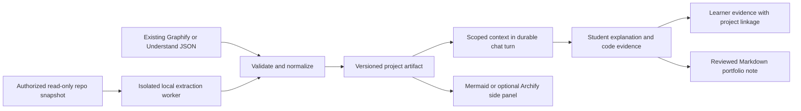

# Help students explain their vibe-coded projects
## Understand-Anything × Archify × Graphify for pi-tutor

**Date:** 2026-10-19 · **Status:** code-grounded design brief; no implementation or runtime benchmark. **Verification: BLOCKED** for the required independent verifier/reviewer stages after provider failures. Lead static source checks completed; limitations below.

## Executive summary

**Recommendation: combine roles, not applications.** Use **Graphify for local code structure**, borrow/import **Understand-Anything’s layers and guided-tour model** for explanations, and add **Archify as an optional presentation renderer** after the student can trace a real feature. Keep DeepTutor chat, Markdown Notes, wiki retrieval and learner evidence as the product surface. Do not install all three agent skills and expect an integrated tutor.

The smallest useful first release imports a pinned graph artifact, shows a focused Mermaid path in the existing side panel, and asks the learner to explain one design decision with code evidence. It need not run any upstream agent or add a graph database. A generated map is **not** evidence of student understanding; only the student’s reasoning should update mastery.

**Ranked ≤3-step build plan:** (1) source-backed local structure and scoped explanation; (2) tour-to-learning-evidence and student-authored portfolio notes; (3) optional Archify interactive/exportable views. These are proposed engineering priorities, not measured learning effects.

## Evidence scope and pinned sources

All three official repository pages were fetched, then shallow source checkouts were read without executing their code. Branch snapshots inspected:

| Target | Inspected commit | Primary source |
|---|---|---|
| Understand-Anything | `f2d0164f72fe678805c34245a6df36acededfebd` | [U0] |
| Archify | `654da74e084e5a1faf708779c23d6172766be9c1` | [A0] |
| Graphify | `86c57be8204673c2a1b9849a3292a7dd3ab373d8` | [G0] |
| Local pi-tutor | `a2bd42a381db61d97915d87cbc984377fb61b438` | local paths in [L] |

Search snippets and old issues were discovery aids, not current implementation proof. No installed size, latency, token totals, dollar cost, browser compatibility or learning outcome was measured. “Local” below describes inspected stages, not a network-isolation certification. [E]

## Comparison: what each actually contributes

| Question | Understand-Anything | Archify | Graphify |
|---|---|---|---|
| Core mechanism | Coding-agent skill coordinates scan, structural extraction, semantic file batches, graph assembly, architecture and tour agents, review/save. | Coding agent reads requirements/repo evidence and authors typed JSON IR; Node CLI validates, lays out and renders diagrams/HTML. Not an automatic repo indexer. | Python local AST extraction and cross-file resolution → graph build → clustering/analysis → JSON, reports, optional HTML/wiki/export. Separate model-based semantic pass for non-code. |
| Best fit here | Guided explanation structure: layers, tours, code-linked summaries. | Focused feature flow, sequence, architecture and portfolio presentation. | Structural substrate and source-location evidence; local-only indexing option. |
| Full installation footprint | Source workflow: Node ≥22, pnpm ≥10, TypeScript build, tree-sitter/native grammar dependencies; dashboard adds React/Vite/layout libraries. Python helpers also appear in the workflow. Separate read-only viewer declares Node ≥18. | Skill package/renderer declares Node ≥18 and no runtime `dependencies` block; development tooling is separate. Full native `finalize` also needs an available Chrome/Chromium browser for its browser gate. | Distribution **`graphifyy`**, CLI **`graphify`**; Python ≥3.10, NetworkX, NumPy, RapidFuzz, tree-sitter runtime and numerous language grammars. MCP, PDF, video, Leiden and model SDK extras add optional footprint; do not install `[all]` for a code map. |
| Model/token-bearing work | Host agent reasoning plus file-analysis batches, architecture, tour and reviews; follow-up explain/chat. Incremental pipeline can avoid model passes for unchanged/cosmetic/deletion paths, but normal semantic updates are not free. | Agent repo reading/IR authoring/repair consumes model tokens. Deterministic validation/layout/rendering itself needs no model. | Code AST extraction/build/clustering need no model. Docs/images/papers semantic extraction and optional LLM dedup/labels/query narration consume tokens when enabled. |
| Local-only boundary | Scanning/parsing, fingerprinting, merging, local graph persistence/search and read-only viewer. Semantic generation is delegated to the host model; local files do not imply local inference. | Render/validate from existing IR can run locally. Full delivery has an update-manifest network check unless disabled. Browser/export features need separate auditing. | Code-only pass can stay local; configured Ollama can provide local semantic inference, but its address is configurable. HTML export loads `vis-network` from an external CDN. |
| Licence at inspected revision | MIT; preserve copyright/permission notice in copied substantial portions. Audit bundled grammars/assets separately. | MIT for own code; retain notices. Bundled font and brand marks have separate terms; brand use is not blanket MIT. | Current package and NOTICE: **Apache-2.0**, with earlier MIT portions retained under `LICENSE-MIT`. Do not describe the current whole project as MIT. |
| Smallest concrete integration | Import `.ua/knowledge-graph.json` (legacy `.understand-anything/` supported) and adapt nodes, layers, tour into native chat/Notes. Zero upstream runtime if the artifact already exists. | Author a small, evidence-linked architecture/sequence IR from the normalized graph; render one trusted HTML artifact into existing side-panel infrastructure. Mermaid remains default. | Import existing `graph.json`, or run a pinned code-only worker; normalize source spans, relation confidence and arc direction. No Graphify server or database required. |

Sources: mechanism/outputs [U1], [U2], [U3], [U4], [A1], [A2], [A3], [G1], [G2], [G3], [G4], [G5]; licence [U5], [A4], [A5], [G6], [G7], [G8]. Footprint comes from manifests and browser-discovery code, not disk measurements. [U6], [U7], [U8], [A0], [A6], [G0]

### Understand-Anything: a teaching-oriented semantic layer, not a free AST graph

The `skills/understand/SKILL.md` workflow dispatches a project scanner and file analyzers, merges batch artifacts with Python, assigns architectural layers and builds a tour. Incremental helpers choose skip/partial/architecture updates and guard against loss of surviving symbols. These are useful design patterns, but they are prompt-orchestrated phases, not proof of a ready Python service API. [U1]

The code-level `KnowledgeGraph` contains `project.gitCommitHash`, `nodes` with `filePath`/`lineRange`/summary, typed edges, `layers` and `tour` steps referring to node IDs. Its chat helper selects graph context and formats a prompt rather than supplying an inference backend. **Import that interchange format first**, validate references and preserve the producer commit. Do not rewrite all relationships as equally factual: the edge schema does not carry Graphify’s same explicit provenance/confidence labels. Assign imported semantic descriptions their own producer/evidence classification. [U2], [U3]

Its standalone viewer is a separate option: it serves a local dashboard, token-protects data endpoints and exposes graph-referenced source files. It is **not** simply self-contained HTML to paste into `srcDoc`. On a remotely hosted DeepTutor, `127.0.0.1` in the student’s browser is not the backend host. Importing JSON avoids local-port lifecycle, token forwarding, file-read and per-user isolation complexity. [U4]

**Risk:** full scans read broad code context through an agent, and the skill can install/build dependencies and redirect worktree output into the main repo. Do not run it verbatim inside a multi-user web request. Pin the producer, control output root, disable ambient hooks and require code-transmission consent. [U1]

### Archify: presentation after evidence, not evidence extraction

The actual contract is requirements/Mermaid/repository investigation → agent-authored JSON IR → typed renderer. Mermaid input is interpreted for meaning and reauthored; this is not a guaranteed lossless syntax conversion. `finalize` is a pipeline of validation, delivery/provenance checks and a real-browser gate for native diagrams; a passing automated receipt does not claim perceptual review or source-semantic correctness. [A1], [A2]

**Smallest adapter:** limit initial scope to architecture or sequence, keep its schema and candidate JSON, attach source references, and invoke the pinned renderer in a bounded job. Use generic nodes before brand assets. Keep the canonical graph outside Archify’s diagram-specific layout IR; regenerating coordinates must not change learning evidence.

There is a material privacy caveat: `bin/delivery-update.mjs` starts a bounded subprocess update check during delivery. Set **`ARCHIFY_UPDATE_CHECK_DISABLED=1`**, bundle approved assets and enforce egress restrictions for an offline promise. Static generation need not call a model, but the agent which writes and repairs IR still does. The complete `finalize` path has browser cost/availability distinct from the lightweight renderer package. [A3], [A6], [A7]

**Licence caveat:** `THIRD_PARTY_NOTICES.md` records font licensing and individual marks, including non-commercial/share-alike metadata. For portfolio exports, use generic shapes or explicitly approved assets and preserve required attribution; do not inherit an icon catalogue without review. [A5]

### Graphify: structural grounding, with careful trust and direction handling

`extract(paths, root=...)` takes a **list of code paths**. It does per-file structure followed by cross-file import/name resolution. Direct syntax-derived relationships and resolver-derived `INFERRED` edges must remain distinguishable; static calls do not prove production runtime behavior, especially dynamic dispatch, dependency injection and framework routing. [G1], [G2]

The CLI’s **`extract --code-only`** skips docs/papers/images semantic extraction. Use a fresh project-specific output directory and do not enable `--dedup-llm`; code-only incremental updates can retain a preexisting semantic layer, so the flag alone does not establish the historical provenance of everything in an existing graph. For the narrowest boundary, call the AST extraction library in a subprocess with explicit `root` and an allowlisted path list. Shared/ambient extractor state is another reason to prefer per-job process isolation over concurrent in-process tenant scans. [G1], [G2], [G3]

**Proposed adapter sketch, not executed:** in a separately installed pinned worker, resolve and authorize the repo root; collect permitted Python/TS/JS paths; call `extract(paths, root=root)`; validate; serialize raw node/edge evidence into DeepTutor’s own envelope. Alternatively consume CLI `graph.json`. Preserve relation multiplicity and arc direction: Graphify documents undirected graph serialization with ordered source/target links and legacy `_src`/`_tgt` markers. A naive NetworkX round-trip can reverse endpoints. Use its loader/direction helpers or normalize raw links explicitly. [G1], [G4]

Local extraction does not imply offline visualization: `exporters/html.py` references a CDN script. Prefer native Mermaid or locally bundled visual assets instead of embedding that HTML unchanged. Current `llm.py` includes configurable OpenAI-compatible provider configuration and Ollama; an older open issue asserting missing compatibility is not reliable evidence against this revision. [G5], [G9]

## Integration with this actual DeepTutor fork

### Existing seams and traps

- **Durable turns:** retain `deeptutor/app/service.py` → turn engine → existing stream event/replay lifecycle. Run indexing as a separate bounded job and reference its artifact from a turn; do not hold a model response open for an entire repo scan. Completion/cancellation/ownership need a job contract, not direct iframe execution. [L]
- **Two execution paths:** `runtime/turn_engine.py` switches to `runtime/pi_turn_engine.py` under `PI_TUTOR_ENGINE`. The latter runs `pi_engine/turn.ts`, whose loader has **`noSkills: true`** and whose active tool list explicitly contains wiki and Canvas tools. Registering a Python built-in or installing upstream skills alone does not expose it here. Add a narrow read-only project-context tool to the selected engine, or start with app-side artifact selection/context injection. Check both paths before claiming support. Legacy mounting is in `agents/_shared/tool_composition.py`, distinct from user-toggleable tools. [L]
- **Markdown Notes ≠ notebook records:** `api/routers/notes.py` stores `.md` files and mounts external `PI_TUTOR_NOTE_SOURCES` read-only; `services/notebook/service.py` is a separate record store with Markdown export. The chat Markdown-note tab uses draft/co-writer helpers. Choose one explicit destination, rather than promising all three are automatically synchronized. [L]
- **Wiki:** `services/rag/pipelines/wiki/pipeline.py` is retrieval-only via qmd. It refuses initialization/document addition. Produce reviewed Markdown into an approved wiki-owned location and let its indexing path handle it; do not call this RAG pipeline an ingestion API. [L]
- **Rendering:** `SessionViewerPanel.tsx` already handles Markdown notes, file and HTML tabs; its HTML `srcDoc` uses `allow-scripts allow-modals`, whereas web URL tabs have broader privileges. `Mermaid.tsx` initializes Mermaid with strict security and no HTML labels. `VisualizationViewer.tsx` has a source-checked message bridge, but the generic HTML tab is a separate route: node-click behavior needs explicit wiring. [L]
- **Mastery:** `services/chat_mastery.py` records learner quotations and evidence kinds from completed turns; the session executor calls `record_turn`. It explicitly excludes mere parroting of tutor language. Its present evidence schema has no repo/node/revision foreign key: add linkage rather than equating concept-name strings with graph IDs. Background extraction is another model cost and its persistence is not the same durability guarantee as the turn log. [L]

### Proposed minimal contract and flow

Use a versioned **ProjectUnderstandingArtifact** (new, not an upstream common standard): `owner_id`, `project_id`, repo revision plus dirty-worktree/content digest, producer/version, scan policy, nodes with source spans, directed relations with evidence kind/confidence, optional layers/tour, and warnings/coverage omissions. Keep student evidence separately keyed to artifact/node and turn. Validate IDs, endpoints, relative-path containment, size and version limits. For external repos, source URLs must be pinned; local paths alone are not portable portfolio citations.

Start with one real user journey: “What happens after clicking Save?” Show evidence-backed frontend handler → request → FastAPI route → storage, with unknown cross-boundary links explicitly labelled. Ask the student to predict a failure, justify a boundary or explain a change, and reveal source progressively. Save their corrected account, a diagram and a trade-off in a portfolio note. Do not label assistant-produced prose “student mastered.” This is a product hypothesis, not a demonstrated pedagogical result.

## Token cost: transparent accounting, no invented price tag

| Operation | Incremental model-token expectation | What remains unmeasured |
|---|---|---|
| Import existing graph, validate, AST extraction, deterministic graph/layout/render | No model invocation required in the restricted design | CPU, RAM, disk, parser coverage, browser overhead |
| Understand full analysis | Host orchestration + per-batch source/context + architecture/tour/review outputs and any retries | All token counts, cache benefit, model/rates |
| Archify authoring | Source investigation + IR generation + repair turns | Tokens per diagram and repair frequency |
| Graphify semantic enrichment | Uncached non-code chunks, optional label/dedup calls and retries | Selected backend consumption and quality |
| DeepTutor learning loop | Scoped graph/source context in chat + background mastery extraction and any enabled follow-ups | Per-student session totals and background work |

“Zero extraction tokens” is not “zero product cost.” Graph reading via an agent and student explanations still use a model. Local models still consume tokens and compute, even without API charges. Library/model-accounting fields are not measurements from this investigation. [U1], [A1], [G3], [G9], [L]

For a proposed pilot, record input/output/cached tokens per stage and retry, separating chat, semantic indexing and background mastery. For model \(m\), with billed token counts \(I_m,O_m,C_m\) and per-token prices \(r_{i,m},r_{o,m},r_{c,m}\):
\[
\text{model charge}=\sum_m(I_m r_{i,m}+O_m r_{o,m}+C_m r_{c,m}).
\]
Cached input must not also be counted in uncached input. Add storage/worker/browser compute separately. No current provider pricing is assumed. Cap scope/response length, cache by revision/content+producer+policy, and request consent before sending code to a remote model.

## Risks, gaps and decision conditions

| Risk | Required mitigation / unresolved check |
|---|---|
| Student code, secrets and dependency scripts | Never run project install hooks/builds for indexing. Read-only snapshot, path/symlink containment, deny `.env`, keys and generated/vendor trees; restrict worker resources and egress. Model-bound source requires consent. Static parsers can still have vulnerabilities. |
| Repo prompt injection and cross-tenant access | Treat comments/README/graph text as untrusted data, never tool instructions. Bind every artifact/source read to owner/project; no arbitrary server-path or unrestricted clone-URL endpoint. |
| HTML is not a network sandbox | `allow-scripts` isolates DOM origin, not outbound requests. CSP/egress policy, bundled scripts/fonts, validated messages with `event.source`, strict message schema and prompt prefill only; no iframe-triggered code execution. Existing KaTeX helper injects CDN assets, so it cannot underpin an offline claim unchanged. [L] |
| Incorrect or stale architecture | Preserve explicit vs inferred links, revision/digests and missing coverage. Require source spans for important claims. Changed/dirty files invalidate prior evidence; do not silently merge historical graphs. |
| Mastery inflation or overclaiming portfolio authorship | Use learner reasoning quotes and novel predictions, not map completion or “I understand.” Human review before publishing; preserve AI assistance/provenance. No validated mastery calibration established here. |
| Upstream churn / dependency conflicts | Pin versions; isolate Graphify from the FastAPI env (its optional MCP/Starlette floors may conflict); own a narrow adapter and golden schema fixtures. Audit licences/assets before redistribution. [G0] |

**Open questions:** Is the shipping deployment using the pi engine or legacy orchestrator? Where may student repos live, and who authorizes scans? Which Markdown/wiki writer owns publication? Can extraction remain code-only? What supported projects break routing/call resolution? What is the acceptable runtime/model budget? Independent citation/review and browser/offline/security tests remain **blocked/not run**; these are launch gates, not hidden implementation details.

## Ranked build plan — at most three steps

1. **Build the evidence spine and one useful feature trace.** Implement JSON import for Graphify and Understand artifacts, normalize/validate a per-owner revisioned envelope, and expose selected subgraphs/source snippets to chat and strict Mermaid. Start with imports; then add isolated Graphify code-only extraction if automatic indexing is needed. Do not embed either full dashboard. **Acceptance:** fixture checks for path traversal, tenant isolation, dangling IDs, reversed/parallel relations and dirty-file freshness; a student can inspect one feature’s source-backed path. All acceptance checks are planned, not run.
2. **Connect tours to explanation and portfolio evidence.** Adapt Understand layers/tour steps to focused conversations. Attach actual learner turn evidence to project concepts, keep uncertainty visible, and save a reviewed Markdown account with pinned code links. Use the existing Notes surface; publish to wiki only through its approved writer/indexer. **Acceptance:** assistant text alone cannot earn understanding credit; student quote/revision lineage survives reload; update invalidation and consent for background model use are tested. Validate learning value with student walkthroughs rather than graph size.
3. **Add Archify only where Mermaid is insufficient.** Support one or two typed diagram modes; retain source-backed candidate IR, disable update checks in offline jobs, run complete delivery/browser checks when claiming them, and present approved HTML through a hardened side-panel bridge. Keep generic assets/licence notices and offer an exportable portfolio view. **Acceptance:** offline browser/network check, malicious-label/message tests and narrow-panel usability review; failed render leaves Mermaid available and does not corrupt canonical evidence.

**Decision:** Graphify first for trustworthy structure; Understand’s interchange/tour design second for learning scaffolding; Archify third for polished communication. Import-first can make Understand artifacts available immediately without paying for their generation inside DeepTutor. Revisit the ranking if existing users already produce reliable Understand graphs or if a diagram-only MVP is the actual goal.

## Sources

Primary repository code and documentation (2026 snapshots). These are source audits, not endorsements of documented performance. Each linked pinned file was fetched and compared byte-for-byte with the inspected checkout; results are in `understand-repos-brief-url-checks.json`. No academic learning-effect claim is relied on.

[U0]: https://github.com/Egonex-AI/Understand-Anything/blob/f2d0164f72fe678805c34245a6df36acededfebd/package.json
- **[U0] Egonex-AI/Understand-Anything — `package.json` (2026)**: https://github.com/Egonex-AI/Understand-Anything/blob/f2d0164f72fe678805c34245a6df36acededfebd/package.json

[U1]: https://github.com/Egonex-AI/Understand-Anything/blob/f2d0164f72fe678805c34245a6df36acededfebd/understand-anything-plugin/skills/understand/SKILL.md
- **[U1] Egonex-AI/Understand-Anything — `understand-anything-plugin/skills/understand/SKILL.md` (2026)**: https://github.com/Egonex-AI/Understand-Anything/blob/f2d0164f72fe678805c34245a6df36acededfebd/understand-anything-plugin/skills/understand/SKILL.md

[U2]: https://github.com/Egonex-AI/Understand-Anything/blob/f2d0164f72fe678805c34245a6df36acededfebd/understand-anything-plugin/packages/core/src/types.ts
- **[U2] Egonex-AI/Understand-Anything — `understand-anything-plugin/packages/core/src/types.ts` (2026)**: https://github.com/Egonex-AI/Understand-Anything/blob/f2d0164f72fe678805c34245a6df36acededfebd/understand-anything-plugin/packages/core/src/types.ts

[U3]: https://github.com/Egonex-AI/Understand-Anything/blob/f2d0164f72fe678805c34245a6df36acededfebd/understand-anything-plugin/src/understand-chat.ts
- **[U3] Egonex-AI/Understand-Anything — `understand-anything-plugin/src/understand-chat.ts` (2026)**: https://github.com/Egonex-AI/Understand-Anything/blob/f2d0164f72fe678805c34245a6df36acededfebd/understand-anything-plugin/src/understand-chat.ts

[U4]: https://github.com/Egonex-AI/Understand-Anything/blob/f2d0164f72fe678805c34245a6df36acededfebd/understand-anything-plugin/packages/viewer/bin/viewer.mjs
- **[U4] Egonex-AI/Understand-Anything — `understand-anything-plugin/packages/viewer/bin/viewer.mjs` (2026)**: https://github.com/Egonex-AI/Understand-Anything/blob/f2d0164f72fe678805c34245a6df36acededfebd/understand-anything-plugin/packages/viewer/bin/viewer.mjs

[U5]: https://github.com/Egonex-AI/Understand-Anything/blob/f2d0164f72fe678805c34245a6df36acededfebd/LICENSE
- **[U5] Egonex-AI/Understand-Anything — `LICENSE` (2026)**: https://github.com/Egonex-AI/Understand-Anything/blob/f2d0164f72fe678805c34245a6df36acededfebd/LICENSE

[U6]: https://github.com/Egonex-AI/Understand-Anything/blob/f2d0164f72fe678805c34245a6df36acededfebd/understand-anything-plugin/packages/core/package.json
- **[U6] Egonex-AI/Understand-Anything — `understand-anything-plugin/packages/core/package.json` (2026)**: https://github.com/Egonex-AI/Understand-Anything/blob/f2d0164f72fe678805c34245a6df36acededfebd/understand-anything-plugin/packages/core/package.json

[U7]: https://github.com/Egonex-AI/Understand-Anything/blob/f2d0164f72fe678805c34245a6df36acededfebd/understand-anything-plugin/packages/dashboard/package.json
- **[U7] Egonex-AI/Understand-Anything — `understand-anything-plugin/packages/dashboard/package.json` (2026)**: https://github.com/Egonex-AI/Understand-Anything/blob/f2d0164f72fe678805c34245a6df36acededfebd/understand-anything-plugin/packages/dashboard/package.json

[U8]: https://github.com/Egonex-AI/Understand-Anything/blob/f2d0164f72fe678805c34245a6df36acededfebd/understand-anything-plugin/packages/viewer/package.json
- **[U8] Egonex-AI/Understand-Anything — `understand-anything-plugin/packages/viewer/package.json` (2026)**: https://github.com/Egonex-AI/Understand-Anything/blob/f2d0164f72fe678805c34245a6df36acededfebd/understand-anything-plugin/packages/viewer/package.json

[A0]: https://github.com/tt-a1i/archify/blob/654da74e084e5a1faf708779c23d6172766be9c1/archify/package.json
- **[A0] tt-a1i/archify — `archify/package.json` (2026)**: https://github.com/tt-a1i/archify/blob/654da74e084e5a1faf708779c23d6172766be9c1/archify/package.json

[A1]: https://github.com/tt-a1i/archify/blob/654da74e084e5a1faf708779c23d6172766be9c1/archify/SKILL.md
- **[A1] tt-a1i/archify — `archify/SKILL.md` (2026)**: https://github.com/tt-a1i/archify/blob/654da74e084e5a1faf708779c23d6172766be9c1/archify/SKILL.md

[A2]: https://github.com/tt-a1i/archify/blob/654da74e084e5a1faf708779c23d6172766be9c1/archify/bin/archify.mjs
- **[A2] tt-a1i/archify — `archify/bin/archify.mjs` (2026)**: https://github.com/tt-a1i/archify/blob/654da74e084e5a1faf708779c23d6172766be9c1/archify/bin/archify.mjs

[A3]: https://github.com/tt-a1i/archify/blob/654da74e084e5a1faf708779c23d6172766be9c1/archify/bin/delivery-update.mjs
- **[A3] tt-a1i/archify — `archify/bin/delivery-update.mjs` (2026)**: https://github.com/tt-a1i/archify/blob/654da74e084e5a1faf708779c23d6172766be9c1/archify/bin/delivery-update.mjs

[A4]: https://github.com/tt-a1i/archify/blob/654da74e084e5a1faf708779c23d6172766be9c1/LICENSE
- **[A4] tt-a1i/archify — `LICENSE` (2026)**: https://github.com/tt-a1i/archify/blob/654da74e084e5a1faf708779c23d6172766be9c1/LICENSE

[A5]: https://github.com/tt-a1i/archify/blob/654da74e084e5a1faf708779c23d6172766be9c1/THIRD_PARTY_NOTICES.md
- **[A5] tt-a1i/archify — `THIRD_PARTY_NOTICES.md` (2026)**: https://github.com/tt-a1i/archify/blob/654da74e084e5a1faf708779c23d6172766be9c1/THIRD_PARTY_NOTICES.md

[A6]: https://github.com/tt-a1i/archify/blob/654da74e084e5a1faf708779c23d6172766be9c1/archify/bin/visual-check.mjs
- **[A6] tt-a1i/archify — `archify/bin/visual-check.mjs` (2026)**: https://github.com/tt-a1i/archify/blob/654da74e084e5a1faf708779c23d6172766be9c1/archify/bin/visual-check.mjs

[A7]: https://github.com/tt-a1i/archify/blob/654da74e084e5a1faf708779c23d6172766be9c1/archify/scripts/update-contract.mjs
- **[A7] tt-a1i/archify — `archify/scripts/update-contract.mjs` (2026)**: https://github.com/tt-a1i/archify/blob/654da74e084e5a1faf708779c23d6172766be9c1/archify/scripts/update-contract.mjs

[G0]: https://github.com/Graphify-Labs/graphify/blob/86c57be8204673c2a1b9849a3292a7dd3ab373d8/pyproject.toml
- **[G0] Graphify-Labs/graphify — `pyproject.toml` (2026)**: https://github.com/Graphify-Labs/graphify/blob/86c57be8204673c2a1b9849a3292a7dd3ab373d8/pyproject.toml

[G1]: https://github.com/Graphify-Labs/graphify/blob/86c57be8204673c2a1b9849a3292a7dd3ab373d8/ARCHITECTURE.md
- **[G1] Graphify-Labs/graphify — `ARCHITECTURE.md` (2026)**: https://github.com/Graphify-Labs/graphify/blob/86c57be8204673c2a1b9849a3292a7dd3ab373d8/ARCHITECTURE.md

[G2]: https://github.com/Graphify-Labs/graphify/blob/86c57be8204673c2a1b9849a3292a7dd3ab373d8/graphify/extract.py
- **[G2] Graphify-Labs/graphify — `graphify/extract.py` (2026)**: https://github.com/Graphify-Labs/graphify/blob/86c57be8204673c2a1b9849a3292a7dd3ab373d8/graphify/extract.py

[G3]: https://github.com/Graphify-Labs/graphify/blob/86c57be8204673c2a1b9849a3292a7dd3ab373d8/graphify/cli.py
- **[G3] Graphify-Labs/graphify — `graphify/cli.py` (2026)**: https://github.com/Graphify-Labs/graphify/blob/86c57be8204673c2a1b9849a3292a7dd3ab373d8/graphify/cli.py

[G4]: https://github.com/Graphify-Labs/graphify/blob/86c57be8204673c2a1b9849a3292a7dd3ab373d8/graphify/export.py
- **[G4] Graphify-Labs/graphify — `graphify/export.py` (2026)**: https://github.com/Graphify-Labs/graphify/blob/86c57be8204673c2a1b9849a3292a7dd3ab373d8/graphify/export.py

[G5]: https://github.com/Graphify-Labs/graphify/blob/86c57be8204673c2a1b9849a3292a7dd3ab373d8/graphify/exporters/html.py
- **[G5] Graphify-Labs/graphify — `graphify/exporters/html.py` (2026)**: https://github.com/Graphify-Labs/graphify/blob/86c57be8204673c2a1b9849a3292a7dd3ab373d8/graphify/exporters/html.py

[G6]: https://github.com/Graphify-Labs/graphify/blob/86c57be8204673c2a1b9849a3292a7dd3ab373d8/LICENSE
- **[G6] Graphify-Labs/graphify — `LICENSE` (2026)**: https://github.com/Graphify-Labs/graphify/blob/86c57be8204673c2a1b9849a3292a7dd3ab373d8/LICENSE

[G7]: https://github.com/Graphify-Labs/graphify/blob/86c57be8204673c2a1b9849a3292a7dd3ab373d8/NOTICE
- **[G7] Graphify-Labs/graphify — `NOTICE` (2026)**: https://github.com/Graphify-Labs/graphify/blob/86c57be8204673c2a1b9849a3292a7dd3ab373d8/NOTICE

[G8]: https://github.com/Graphify-Labs/graphify/blob/86c57be8204673c2a1b9849a3292a7dd3ab373d8/LICENSE-MIT
- **[G8] Graphify-Labs/graphify — `LICENSE-MIT` (2026)**: https://github.com/Graphify-Labs/graphify/blob/86c57be8204673c2a1b9849a3292a7dd3ab373d8/LICENSE-MIT

[G9]: https://github.com/Graphify-Labs/graphify/blob/86c57be8204673c2a1b9849a3292a7dd3ab373d8/graphify/llm.py
- **[G9] Graphify-Labs/graphify — `graphify/llm.py` (2026)**: https://github.com/Graphify-Labs/graphify/blob/86c57be8204673c2a1b9849a3292a7dd3ab373d8/graphify/llm.py

- **DeepTutor local source snapshot [L]**: `/home/phroggingphrog/projects/pi-tutor`, commit `a2bd42a381db61d97915d87cbc984377fb61b438`. Paths in the integration section are relative to this checkout; not claimed as public URLs.
- **Audit notes and exact queries [E]**: [research-direct](.drafts/understand-repos-brief-research-direct.md); [URL/content check results](.drafts/understand-repos-brief-url-checks.json). The local assertion record and lead verification note are also under `.drafts/`.

[L]: ../../../deeptutor/app/service.py
[E]: .drafts/understand-repos-brief-research-direct.md
